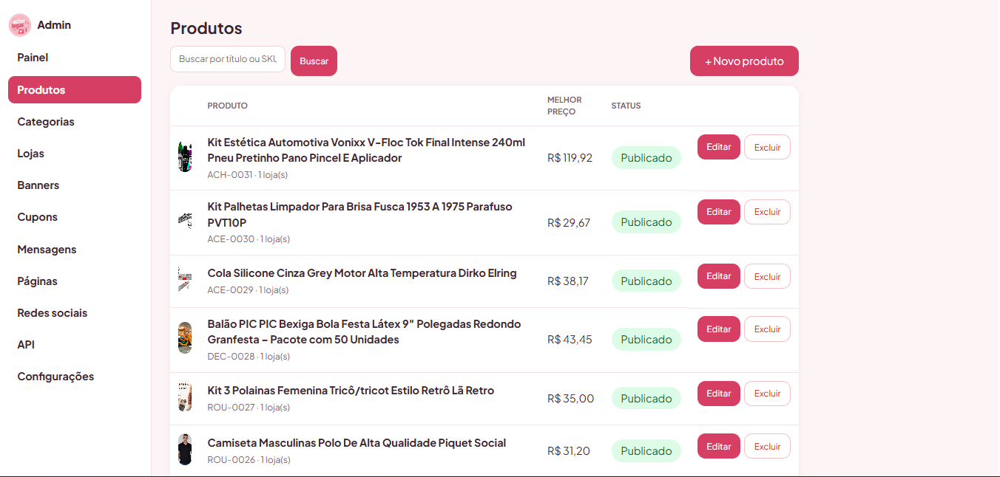

# 🛍️ AcheiLegal — Vitrine de Achadinhos com Links de Afiliado

> Site de achadinhos que reúne produtos de várias plataformas de afiliados (Shopee, Amazon, Mercado Livre, Hotmart e outras) em uma vitrine única, com painel administrativo completo.

🔗 **Site no ar:** https://acheilegal4.com.br


---

## ✨ Funcionalidades

**Site público**
- Vitrine de produtos com categorias e busca
- Destaques da semana com rolagem automática
- Página por loja parceira com botão **"Pegar cupom"**
- Aba de **Cupons** com datas de validade
- Banners temáticos trocáveis (Halloween, Black Friday, 11.11, 12.12)
- Layout responsivo (PC e celular)

**Painel administrativo (`/admin`)**
- Login de administrador
- Cadastro, edição e remoção de produtos, categorias, lojas e cupons
- Plataformas de afiliado ilimitadas (adicionar/remover)
- Importação de produto pelo link (API de afiliados da Shopee)
- Nome, logo e favicon configuráveis
- Contagem de cliques por produto

**Outros**
- Instalação guiada em `/install`
- API REST em `/api/v1`

## 🛠️ Tecnologias

| Camada | Tecnologia |
|---|---|
| Back-end | PHP 8.3 puro (sem framework) |
| Banco de dados | SQLite |
| Front-end | HTML5, CSS3 e JavaScript puros |
| Hospedagem | HostGator (cPanel) + SSL |

## 🔒 Segurança aplicada

- Senhas com `password_hash()` e comparação segura com `password_verify()`
- *Prepared statements* em todas as consultas (contra SQL Injection)
- Token CSRF em todos os formulários, comparado com `hash_equals()`
- Escape de saída HTML com `htmlspecialchars()` (contra XSS)
- Limite de tentativas de login e de envio de formulários (contra força bruta e spam)
- Sessão regenerada no login, cookie `HttpOnly`, `SameSite` e `Secure`
- Upload de imagem validado pelo conteúdo real (`finfo`) e regravado em PNG com nome aleatório
- Proteção contra SSRF ao baixar imagens externas (bloqueia IPs internos)
- Chaves da API REST guardadas só em hash SHA-256
- Pasta `storage/` bloqueada para acesso web; banco e segredos fora do repositório
- Cabeçalhos `X-Content-Type-Options`, `X-Frame-Options` e `Referrer-Policy`

## 🚀 Como rodar localmente

```bash
# 1. Clonar
git clone https://github.com/julio122dev/achei-legal.git
cd achei-legal

# 2. Iniciar o servidor embutido do PHP
php -S localhost:8000 -t public public/index.php
```

No Windows, basta dar dois cliques em `INICIAR_SITE.bat`.

3. Abra `http://localhost:8000` — a instalação guiada cria o administrador e o banco SQLite em `storage/`.

Requisitos: PHP 8+ com as extensões `pdo_sqlite`, `curl` e `gd`.

## 📸 Telas

| Home | Painel ADM | Celular |
|---|---|---|
|  |  |  |

## 👨‍💻 Autor

**Júlio César Camilo** — estudante de Análise e Desenvolvimento de Sistemas
[LinkedIn](https://linkedin.com/in/julio-camilo-9b53a7257) · [GitHub](https://github.com/julio122dev)
